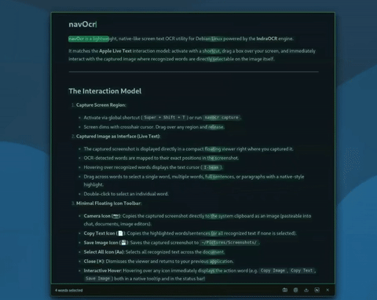

# navOcr 🔍
<p align="center">
  
</p>

**navOcr** is a fast, native-like screen text OCR utility for Debian and Linux desktop environments, powered by the **IndraOCR** CPU engine.

It brings the fluid experience of **Apple Live Text** and **Google Lens** directly to the Linux desktop: press `PrintScreen`, drag a box over any area of your screen, and interact with the recognized text directly on the screenshot through continuous document-like text selection and optical neon illumination.

---

## ✨ Features

- **Live Text on Linux**: The captured screenshot remains as the high-resolution background; recognized text is selectable directly over the image.
- **Continuous Document Selection**: Select text naturally across words, sentences, and paragraphs without breaking at word boundaries.
- **Sub-100ms Inference**: Uses IndraOCR's in-memory ONNX CPU models for fast, private, offline OCR.
- **Animated Optical Neon Shimmer**: Features an animated horizontal light sweep that illuminates recognized glyphs with an optical scanner aesthetic.
- **Deep Elevation Shadow**: High-contrast 42px drop shadow and sleek 1.5px border ensures the viewer floats above identical desktop content.
- **Sleek Minimal Toolbar**:
  - 📷 **Copy Image**: Copies the raw screenshot PNG directly to the system clipboard.
  - 📄 **Copy Text**: Copies highlighted words/sentences (or all text if none is selected).
  - 💾 **Save Image**: Saves the captured screenshot to `~/Pictures/Screenshots/`.
  - **Aa Select All**: Selects all recognized text across the document.
  - **✕ Close**: Dismisses the capture immediately (or press `Esc`).
- **Interactive Tooltips & Hover**: Hovering over any action icon displays the action name both in a floating tooltip and in the toolbar status bar.
- **Global Shortcut**: Automatically binds to the `PrintScreen` key on MATE / Linux desktops.

---

## 🚀 Quick Start

### 1. Installation

Clone and install with the one-step installer:

```bash
git clone https://github.com/onisajr/navOCR.git
cd navOCR
./install.sh
```

The installer will:
1. Register `navocr` into `~/.local/bin/navocr`.
2. Install `navocr.desktop` into `~/.local/share/applications/`.
3. Configure the **PrintScreen** key to trigger `navocr capture` on MATE desktop automatically.

### 2. Verify Installation

Run the self-test:

```bash
navocr test
```

---

## ⌨️ Shortcut Configuration

### Automatic (MATE Desktop)
During installation via `./install.sh`, the `PrintScreen` key is automatically mapped to `navocr capture` via `gsettings`.

### Manual Configuration

If using another desktop environment, bind `navocr capture` to `PrintScreen`:

- **GNOME**:
  1. Open **Settings** > **Keyboard** > **View and Customize Shortcuts** > **Custom Shortcuts**.
  2. Click **+** and set:
     - Name: `navOcr`
     - Command: `navocr capture`
     - Shortcut: `Print` (PrintScreen)

- **XFCE**:
  1. Open **Settings** > **Keyboard** > **Application Shortcuts**.
  2. Add `navocr capture` and press `Print`.

- **i3 / Sway**:
  Add to your `~/.config/i3/config`:
  ```text
  bindsym Print exec --no-startup-id navocr capture
  ```

---

## 🛠️ CLI Usage

| Command | Action |
|---|---|
| `navocr capture` | Instantly snips screen and displays Live Text viewer |
| `navocr daemon` | Runs background service listening for hotkey + system tray |
| `navocr test` | Runs diagnostic self-test verifying IndraOCR and clipboard |
| `navocr config` | Displays active configuration and path |

---

## ⚙️ Configuration

Settings are saved in `~/.config/navocr/config.json`:

```json
{
  "shortcut": "<print_screen>",
  "shortcut_display": "PrintScreen",
  "auto_copy": false,
  "dim_opacity": 0.45,
  "threads": 4,
  "show_tray_icon": true
}
```

---

## 🗑️ Uninstallation

```bash
cd navOCR
./uninstall.sh
```

---

## 📄 License

MIT License. Built with IndraOCR and PyQt5.
